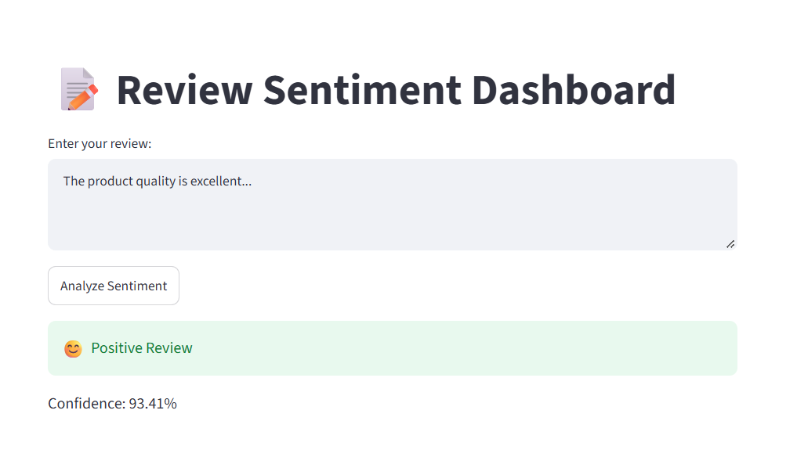
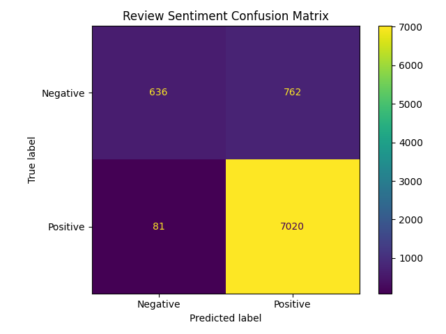

📝 Review Sentiment Dashboard

A machine learning web application that predicts whether a customer review is Positive or Negative using TF-IDF and Logistic Regression.

🚀 Live Demo

## Live Demo

🚀 [Open the Live App](https://ai-project-uxokfvmcxpz9invhxdxjwa.streamlit.app/)   

📌 Problem

Online businesses receive a large number of customer reviews, making it difficult to manually analyze customer feedback.

This project automatically analyzes a customer review and classifies it as Positive or Negative, helping businesses understand customer sentiment quickly.

👥 Who Can Use It?

E-commerce businesses

Product sellers

Customer support teams

Businesses analyzing customer feedback

🎯 Project Objective

The project follows a complete machine learning pipeline:

Raw Data → Data Cleaning → Text Preprocessing → TF-IDF → Logistic Regression → Evaluation → Streamlit App

📊 Dataset

The project uses customer review data containing product reviews and ratings.

The original dataset contains 50,000 reviews.

Reviews with a score of 3 were removed because they represent neutral sentiment.

The sentiment labels were created as:

Score 4–5 → Positive

Score 1–2 → Negative

After cleaning and removing duplicates, the dataset contains approximately 42,495 reviews.

🧹 Data Cleaning

The following preprocessing steps were performed:

Removed neutral reviews

Removed missing review text

Removed duplicate reviews

Converted text to lowercase

Removed URLs

Removed HTML tags

Removed special characters

Removed extra spaces

🤖 Machine Learning Model

The project uses a Scikit-learn Pipeline containing:

TF-IDF Vectorizer

Logistic Regression

TF-IDF converts review text into numerical features, while Logistic Regression performs the sentiment classification.

📈 Model Evaluation

The model was evaluated using:

Accuracy

Precision

Recall

F1-score

Confusion Matrix

5-fold Cross-Validation

The current test-set accuracy is approximately 90%.

The model performs strongly on positive reviews, while negative-review recall is lower because the dataset contains substantially more positive reviews than negative reviews.

This class imbalance is an important limitation of the current model.

🔍 Confusion Matrix

🖥️ Application

The Streamlit application allows a user to enter a customer review and receive:

Sentiment prediction

Prediction confidence

Example:

Input:

The product quality is excellent and I really love it.

Output:

😊 Positive Review

Input:

The product is terrible and completely useless.

Output:

😞 Negative Review

📁 Project Structure

review-sentiment-dashboard/
│
├── data/
│   └── Review.csv
│
├── images/
│   └── confusion_matrix.png
│
├── models/
│   └── sentiment_model.pkl
│
├── notebooks/
│   └── sentiment.ipynb
│
├── app.py
├── requirements.txt
├── .gitignore
└── README.md

⚙️ Run Locally

Clone the repository:

git clone [YOUR_GITHUB_REPOSITORY_URL](https://github.com/thadodaurvashi16/ai-project/tree/main/review-sentiment-dashboard)

Go inside the project:

cd review-sentiment-dashboard

Create a virtual environment:

python -m venv .venv

Activate it on Windows:

.venv\Scripts\Activate.ps1

Install dependencies:

pip install -r requirements.txt

Run the Streamlit application:

streamlit run app.py

🔮 Future Improvements

Possible improvements include:

Improve negative-review recall

Handle class imbalance using class weights or resampling

Experiment with other machine learning models

Add review statistics and sentiment charts

Add batch CSV prediction

Add more advanced NLP techniques

Improve the Streamlit dashboard UI

🛠️ Technologies

Python

Pandas

NumPy

Scikit-learn

TF-IDF

Logistic Regression

Matplotlib

Jupyter Notebook

Streamlit

👩‍💻 Author

Thadoda Urvashi

## 🖥️ Application Screenshot

